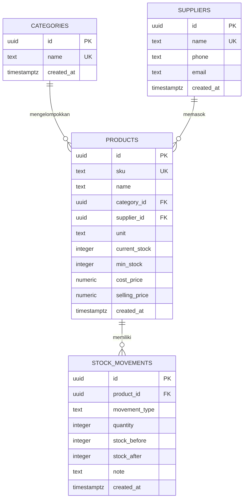

# Sistem Persediaan Pancingku

Aplikasi inventaris sederhana dengan frontend HTML/CSS/JavaScript dan backend Node.js bawaan. Database menggunakan Supabase PostgreSQL. Tidak memakai `package.json` maupun `env.example`.

## Struktur

```text
frontend/
  index.html
  styles.css
  app.js
backend/
  app.js
  schema.sql
```

## ERD



## Menjalankan

1. Di Supabase, buka **SQL Editor**, jalankan seluruh isi `backend/schema.sql`.
2. Di **Authentication > Users**, buat atau undang pengguna dengan email dan password. Pastikan email sudah dikonfirmasi; provider email project harus aktif.
3. Buka `frontend/index.html` langsung atau gunakan Node.js 18+ untuk menjalankan server:

   ```powershell
   node backend/app.js
   ```

4. Jika memakai server, buka `http://localhost:3000`. Masuk dengan email/password pengguna Supabase.

URL dan publishable key project telah diatur di `frontend/app.js` dan `backend/app.js`. RLS hanya mengizinkan role `authenticated`; jangan mengganti publishable key dengan `service_role` key.

Schema SQL perlu dijalankan ulang setelah perubahan CRUD. Produk dapat ditambah, diedit, dan dihapus; ketika dihapus, seluruh riwayat mutasinya ikut dihapus. Kategori dan pemasok dapat dikelola terpisah; bila dihapus, produk terkait tetap ada tanpa relasi tersebut. Mutasi yang diedit atau dihapus harus menjadi mutasi terbaru produknya, dan stok akan dihitung ulang dalam transaksi.
